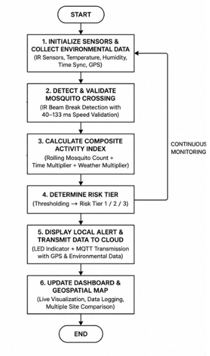
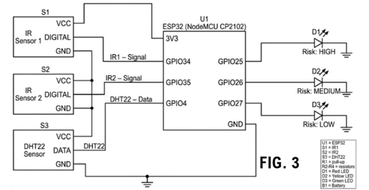
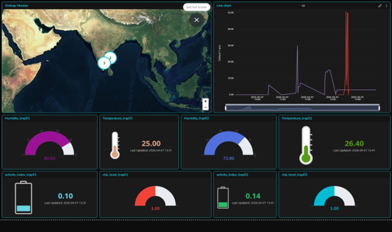
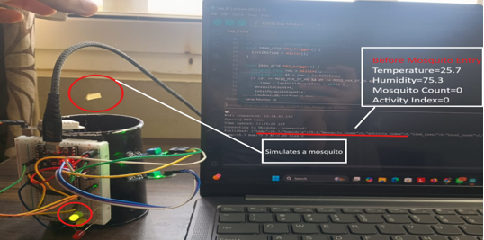
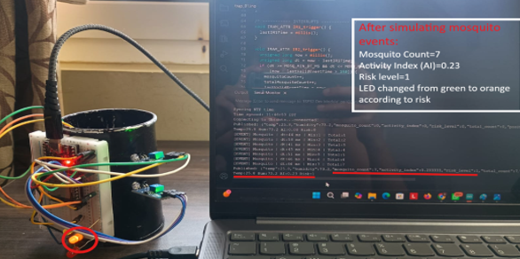

# Smart Ovitrap — IoT Mosquito Activity Monitoring

An ESP32-based smart ovitrap that combines dual-IR entry sensing,
temperature and humidity monitoring, local activity indicators, and
MQTT telemetry to Ubidots.

## Overview

The system monitors optical crossing events at the trap entrance and
uses timing-based filtering to identify candidate entry events.

An ESP32 combines the event count with environmental measurements
and time-of-day weighting to calculate an Activity Index. The result
is displayed locally through LEDs and transmitted to Ubidots for
remote monitoring and comparison across trap locations.

## Features

- Dual-IR sensing with timing-based event filtering
- DHT22 temperature and humidity measurements
- On-device Activity Index calculation
- Low, medium, and high activity indicators
- Wi-Fi connectivity and MQTT telemetry
- Ubidots dashboard with trends and trap locations
- Configurable node ID and coordinates for multi-node deployments

## System Architecture

Dual IR Sensors + DHT22
          ↓
        ESP32
          ↓
Event Filtering → Activity Index → Status LEDs
          ↓
     Wi-Fi / MQTT
          ↓
  Ubidots Dashboard
          ↓
Trends and Location-Based Monitoring

## Hardware

| Component | Purpose |
|-----------|---------|
| ESP32 | Sensor processing, index calculation, and MQTT communication |
| Two IR sensor modules | Detect sequential interruptions at the entrance |
| DHT22 | Measure temperature and humidity |
| Red, yellow, and green LEDs | Display the activity category |
| Breadboard and jumper wires | Prototype interconnections |
| Trap enclosure | House the sensing arrangement |

### Pin Connections

| Component | ESP32 GPIO |
|-----------|------------|
| IR sensor 1 output | GPIO34 |
| IR sensor 2 output | GPIO35 |
| DHT22 data | GPIO4 |
| Red LED | GPIO25 |
| Yellow LED | GPIO26 |
| Green LED | GPIO27 |

For the sensing logic, biological reasoning, and Activity Index design,
see [How It Works](docs/how-it-works.md).

## Cloud Dashboard

The Ubidots dashboard displays environmental measurements,
entry-event counts, Activity Index, and activity categories.

Location data allows readings from different trap nodes to be
compared on a map.

## Prototype Testing

The prototype was tested using simulated crossing events.

Testing demonstrates:
- Event registration and timing-based filtering
- Temperature and humidity acquisition
- Activity Index updates
- Local LED indication
- Cloud telemetry and multi-node dashboard display

### Baseline

### After Simulated Events

## Limitations

- Timing-based optical filtering does not establish mosquito species.
- Accepted crossing events are not independently verified mosquito counts.
- The Activity Index is a prototype monitoring metric, not a validated
  prediction of dengue or other disease transmission.
- Broader field testing is required to assess detection accuracy,
  false positives, and outdoor reliability.
- A location map shows monitored trap sites; continuous area-wide
  heatmaps require additional spatial processing and sufficient coverage.

## Future Work

- Field validation against manually verified observations
- Improved weather-resistant enclosure
- Offline buffering and recovery testing
- Additional monitoring nodes
- Area-wise aggregation and heatmap visualization

